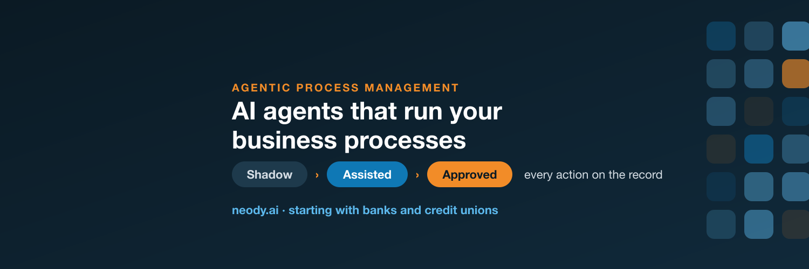

  

# NeodyAI

**Agentic Process Management: AI agents run your business processes, with every action governed and on the record.**

AI agents do the work of a business process. NeodyAI manages the process around them: who owns it, how far the agents may go, and the evidence of everything they did.

We're starting where the bar is highest: **community banks and credit unions**, which carry the same compliance and operations load as the largest banks with far smaller teams. If agents can earn approval from a bank's model-risk team, they can pass any review.

## How it works

Every process moves through three stages:

| Stage | What the agents do |
|---|---|
| **Shadow** | Run alongside your team. Nothing they do takes effect. |
| **Assisted** | Prepare the work. Your staff review and approve it. |
| **Approved** | Run the process with guardrails, once model risk signs off. |

At every stage, each agent action is logged with its inputs, its reasoning and who approved it, so examiners and auditors can see exactly what happened.

## Built on open standards

NeodyAI agents communicate over [Agent Messaging](https://agentmessaging.ai/), an open protocol for agents to message each other, co-developed by our founder.

## Links

- 🌐 Website: [neody.ai](https://neody.ai)
- 🖥️ Product: [app.neody.ai](https://app.neody.ai)
- 💼 LinkedIn: [NeodyAI](https://www.linkedin.com/company/neodyai)
- 𝕏 X: [@neodyai](https://x.com/neodyai)

---

Working at a community bank or credit union and want to see it run on one of your processes? Reach us through [neody.ai](https://neody.ai).
